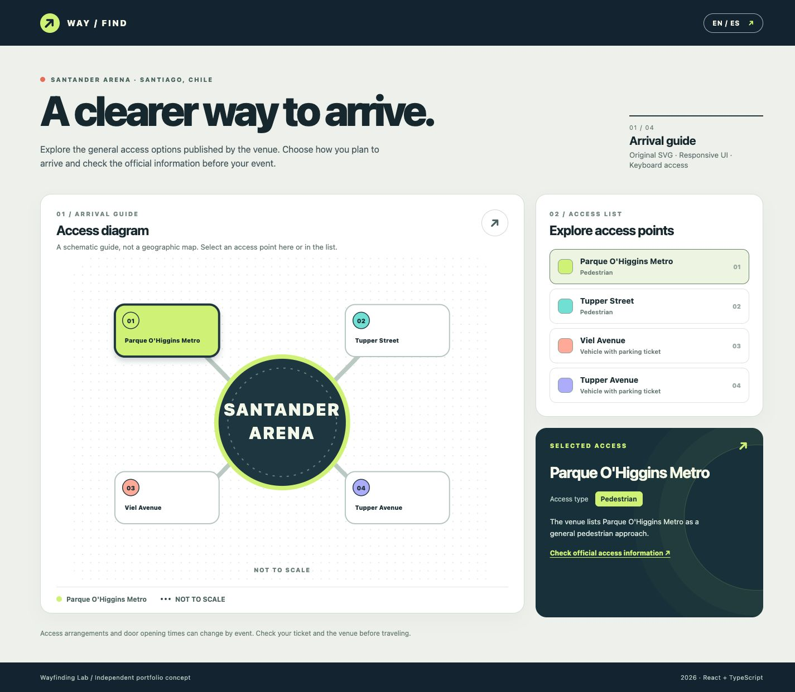
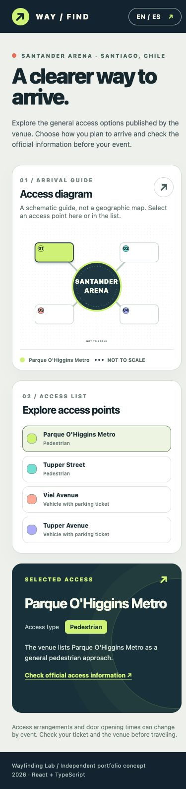

# Way / Find — Santander Arena access explorer

An independent, bilingual React and TypeScript prototype for exploring the **general arrival options** published by Santander Arena in Santiago, Chile. The SVG and interface were designed for this project. This is a portfolio concept, not an official venue service.



## Why this project exists

Crowded event arrivals are easier when an interface separates **how to reach the venue** from **where to sit**. This MVP focuses on the first question. A visitor can compare the two published pedestrian approaches and the two published vehicle approaches without assuming that a particular seating section maps to a specific entrance.

The venue states that general pedestrian access is via Parque O'Higgins Metro or calle Tupper. Vehicle access requires a parking ticket and uses Av. Viel or Av. Tupper according to that ticket. Opening times may vary by event. [Official arrival information](https://www.santanderarena.cl/como-llegar-a-santander-arena).

## What the prototype does

- Shows four access options in an original, **not-to-scale** SVG diagram and a text list.
- Keeps the diagram, list, and detail card synchronized when an option is selected.
- Supports keyboard selection with Enter or Space and visible focus states.
- Switches between English and Spanish without losing the current selection.
- Links each selected option to the venue's official access page.
- Works at narrow and wide viewport sizes.



## Scope and accuracy

The diagram is conceptual and does **not** depict the physical location of streets, gates, or paths. It does not calculate routes, read tickets, collect location data, or claim to know event-specific door assignments. The names and access conditions above are drawn from the venue's published page; the UI design, explanatory text, and SVG are original. No venue logo, seating map, photograph, or proprietary asset is copied.

The venue may update its access guidance. This static prototype should not be used as travel instructions without checking the official page and the ticket for a specific show.

## Acceptance criteria

1. Selecting any of the four options in the list marks the corresponding SVG node as selected and updates the detail card.
2. Selecting an SVG node with a pointer, Enter, or Space updates the list and detail card.
3. Switching language preserves the selected option and updates the document language.
4. Vehicle options always state that a parking ticket is required and that the ticket determines the access street.
5. At 390, 768, and 1440 CSS px, there is no horizontal page overflow.
6. A link to the official venue access page remains available from the detail card.

## Run locally

Node.js 20.19+ is required. The project uses pnpm and includes a lockfile.

```sh
pnpm install
pnpm dev
```

## Verify

```sh
pnpm lint
pnpm test
pnpm build
```

The interaction tests cover synchronized selection, keyboard access, and language persistence. Build and lint checks cover the TypeScript and Vite app. The responsive layout was also inspected in a browser at the three widths above.

## Repository history

Commits follow Conventional Commits. The project began as a fictional venue prototype; the later `feat` commit replaces the fictional sections with sourced access options for Santander Arena. This history is intentional and makes the design decision inspectable.

## Future idea

An event-specific version could compare a ticket's section with that event's published seating and entry information. That needs verified, event-specific source data and a separate review before implementation. It is outside this MVP.
