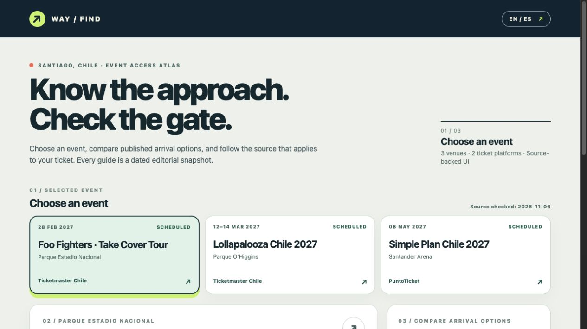
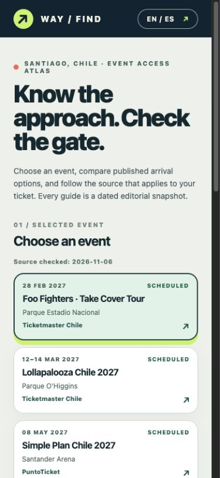

# Way / Find — Santiago Event Access Atlas

An independent React + TypeScript portfolio prototype that pairs **event listings** with **published ways to approach each venue**. The interface is bilingual, keyboard accessible, and built around original SVG diagrams. It is an editorial snapshot, not an official ticketing or navigation service.

**Live demo:** [Explore Way / Find](https://way-find-venue-guide.regina-galve-9336.chatgpt.site)



**Portfolio task sample:** [a screenshot-grounded coding brief with a starter commit, reference implementation, and objective grading criteria](tasks/01-visual-event-atlas/README.md).

## The problem

An event listing tells you *what* and *when*. Venue guidance tells you *how to approach the site*. The exact gate may depend on the show or the ticket. Way / Find keeps those three pieces distinct so a visitor can compare options without mistaking a general venue approach for a confirmed event entrance.

## Event snapshot

Source review: **6 November 2026**. Dates and arrangements can change; the original listings remain the authority.

| Event | Date | Venue | Listing | Arrival source |
| --- | --- | --- | --- | --- |
| Foo Fighters · Take Cover Tour | 28 February 2027 | Parque Estadio Nacional | [Ticketmaster Chile](https://www.ticketmaster.cl/event/foo-fighters-live-2027-scl) | [Parque Estadio Nacional](https://parqueestadionacional.cl/como-llegar) |
| Lollapalooza Chile 2027 | 12–14 March 2027 | Parque O'Higgins | [Ticketmaster Chile](https://www.ticketmaster.cl/event/lollapalooza-chile-2027) | [Lollapalooza Chile FAQ](https://lollapaloozacl.com/preguntas-frecuentes/) |
| Simple Plan Chile 2027 | 8 May 2027 | Santander Arena | [PuntoTicket](https://www.puntoticket.com/simple-plan-2027) | [Santander Arena FAQ](https://www.santanderarena.cl/preguntas-frecuentes) |

The catalog is deliberately small and reviewed by hand. It does not scrape ticket sellers, infer gates from seating sections, promise a route, or track a visitor's location. The diagrams are conceptual and not to scale. Option coordinates are graphic layout positions, not geographic coordinates. Venue names and access conditions come from the cited sources; artwork, layout, and SVG are original.

## What works

- Select one of three events to update the venue diagram, arrival choices, detail card, and source links together.
- Select an option in the diagram or list by pointer or keyboard; both controls remain in sync.
- Switch between English and Spanish without losing the event or option.
- Show a dated source review and label a completed event as past. A multi-day event stays scheduled through its final day.
- See vehicle parking conditions only where published, including the requirement to follow the parking ticket at Santander Arena.
- Use the interface at desktop and mobile widths; the readable option list remains below the compact mobile diagram.



## Objective acceptance criteria

1. Choosing each event changes the venue title, diagram nodes, option list, detail text, and both external links to that event's data.
2. Choosing an option in the diagram changes its `aria-pressed` state and the selected list item and detail card; list selection does the same in reverse.
3. An SVG option responds to Enter and Space. Every control has a visible keyboard focus state.
4. Language switching updates visible copy and the document language while preserving selection.
5. The event list shows a source review date. On 13 March 2027 Lollapalooza remains scheduled; on 15 March it is past.
6. No diagram implies street geometry or a ticket-specific gate. The event listing and arrival guidance are separately linked.
7. At 390, 768, and 1440 CSS px the page has no horizontal overflow.

## Run and verify

Requires Node.js 20.19+ or 22.12+ and pnpm. The lockfile is committed.

```sh
pnpm install
pnpm dev
pnpm lint
pnpm test
pnpm build
```

The interaction tests cover event changes, synchronized selection, keyboard input, language persistence, and date boundaries. Lint and the production build were also run. The interface was inspected in a browser at desktop and mobile widths.

## Incremental history

The repository began as a small fictional venue study. Later commits replaced it with sourced Santander Arena guidance and expanded the verified interaction into a three-event atlas. The UI, tests, documentation, and hosting configuration were added in separate Conventional Commits.
